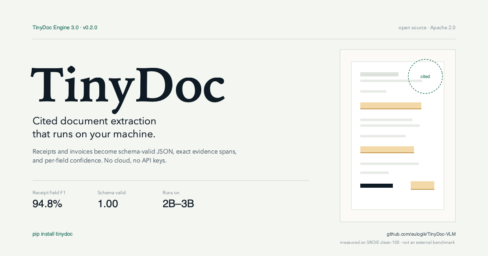
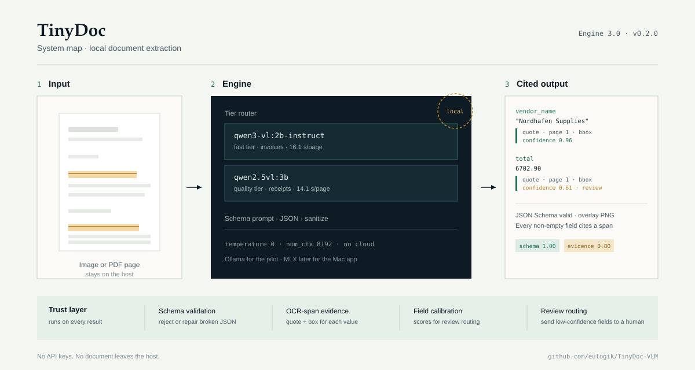
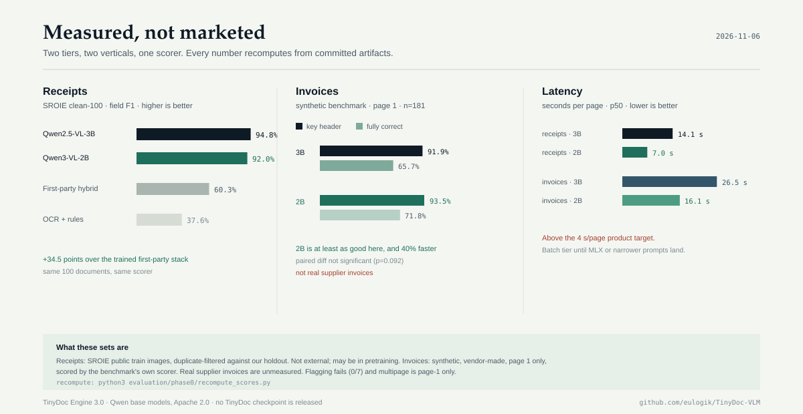
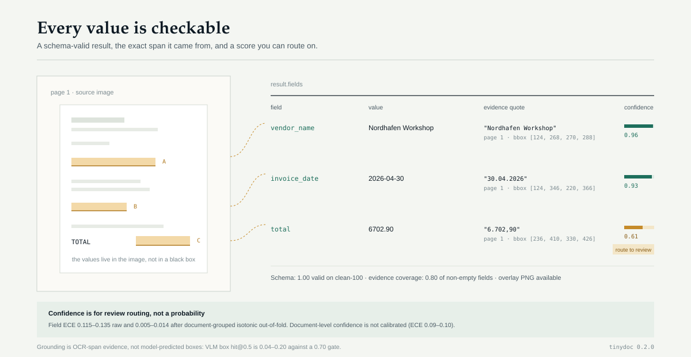

<div align="center">



<p><b>Local-first document extraction with evidence you can check.</b><br>
Schema-valid JSON · exact OCR-span evidence · per-field confidence · Apache 2.0</p>

[](https://pypi.org/project/tinydoc/)
[](https://pypi.org/project/tinydoc/)
[](https://github.com/eulogik/TinyDoc-VLM/actions)
[](LICENSE)
[](https://huggingface.co/spaces/eulogik/TinyDoc-VLM)
[](tests/)

</div>

## What is TinyDoc?

**TinyDoc is an open-source Python SDK and CLI that turns receipt and invoice
images into schema-validated JSON, with the exact source span and a confidence
score attached to every field.** It runs a local vision-language model through
[Ollama](https://ollama.com) — no API key, no cloud, no telemetry — then adds
schema validation, OCR-span evidence, and field-level review routing.

It is **not** a fine-tuned TinyDoc checkpoint. The reader is a third-party base
model (Qwen2.5-VL-3B or Qwen3-VL-2B-Instruct, Apache 2.0); the product is the
grounded extraction layer around it. The first-party 256M checkpoint is retired
(OCRBench 0.0%) and the SmolVLM2-2.2B SFT track is closed (no gain over base).

**Measured today:** **0.9475** field F1 on SROIE clean-100 with Qwen2.5-VL-3B and
**0.9200** with Qwen3-VL-2B-Instruct at 2× the speed. On a synthetic 181-page
invoice probe, **65.7%** (3B) and **71.8%** (2B) of documents are fully correct.
Real supplier invoices are still unmeasured. Full provenance and caveats are in
[`docs/BENCHMARKS.md`](docs/BENCHMARKS.md).

<a id="at-a-glance"></a>

| | |
|---|---|
| **Install** | `pip install tinydoc` (0.2.0) |
| **Runtime** | Local Ollama; Python 3.9+; no API key |
| **Readers** | `qwen2.5vl:3b` (quality) · `qwen3-vl:2b-instruct` (fast) |
| **Output** | Schema-valid JSON + per-field quote/bbox + confidence + optional overlay PNG |
| **Receipts** | 0.9475 / 0.9200 field F1 on SROIE clean-100 (not external) |
| **Invoices** | 91.9% / 65.7% (3B) · 93.5% / 71.8% (2B) key-header / fully correct, synthetic page 1 |
| **Multipage** | 4/10 fully correct vs 0/10 page-1 · 46 pages · 2B · n=10, descriptive |
| **DocVQA (reading)** | 0.829 ANLS / 0.765 exact · 200 public images · single-reference |
| **Not yet measured** | Real supplier invoices, SDK multipage path |
| **License** | Apache 2.0 (SDK); Qwen base models are Apache 2.0 |

## Quick start

```bash
pip install tinydoc==0.2.0

# Pull one local reader (choose one or both)
ollama pull qwen2.5vl:3b            # quality tier
ollama pull qwen3-vl:2b-instruct    # fast tier — use the -instruct tag
```

```python
from tinydoc import ReceiptPipeline

pipe = ReceiptPipeline("ollama:qwen2.5vl:3b")
result = pipe.extract("receipt.jpg")

print(result.fields)        # {"company": ..., "date": ..., "address": ..., "total": ...}
print(result.schema_valid)  # True
print(result.confidence)    # aggregate 0..1, for routing only
for field in result.field_results:
    print(field.name, field.value, field.confidence)
    print("  evidence:", field.evidence.quote, field.evidence.bbox)
```

```bash
tinydoc extract ./receipts/ --engine ollama:qwen2.5vl:3b \
    --out results.jsonl --overlay overlays/
```

A run returns a `DocumentResult`; `tinydoc.draw_overlay` renders the cited spans
onto a PNG. The local Gradio demo is `python demo/app.py --share` (requires Ollama).

> **Large scans:** keep `TINYDOC_OLLAMA_NUM_CTX=8192` (the default). The old
> implicit 4096 rejected 2481×3508 scans with HTTP 400. Never send Ollama
> `format: "json"`; constrained decoding truncates long addresses.

## Architecture



A document enters the **tier router**, runs through a local VLM with a
schema-driven prompt, and is then passed through the **trust layer**:

- **Schema validation** — reject or repair broken JSON before it reaches your code.
- **OCR-span evidence** — RapidOCR word boxes are aligned to each field, producing
  a quote and bounding box. This is provenance from the page, not a model-predicted box.
- **Field confidence** — a calibrated score for review routing (see caveats below).
- **Review routing** — low-confidence fields can be sent to a human instead of
  silently accepted.

The figure is available as [`SVG`](docs/assets/architecture.svg) and
[`PNG`](docs/assets/architecture.png).

## Measured results



Same 100 receipts, same prompt, same scorer, same 8k context, Ollama Q4,
temperature 0:

| System | Field F1 | Address | Schema | Median latency | Errors |
|---|---:|---:|---:|---:|---:|
| **Qwen2.5-VL-3B** — quality tier | **0.9475** | 0.86 | 1.00 | 14.1 s | 0 |
| **Qwen3-VL-2B-Instruct** — fast tier | **0.9200** | 0.84 | 1.00 | **7.0 s** | 0 |
| Hybrid v2 — first-party, shipped | 0.603 | 0.37 | 0.93 | ~8 s | — |
| PP-OCR + heuristics | 0.376 | 0.03 | — | — | — |
| Tesseract + regex | 0.227 | — | — | — | — |

**Invoices** — public synthetic benchmark, page 1 only, 181 documents:

| Tier | Key-header accuracy | Fully correct | p50 latency |
|---|---:|---:|---:|
| Qwen2.5-VL-3B | 91.9% | 65.7% | 26.5 s |
| Qwen3-VL-2B-Instruct | **93.5%** | **71.8%** | **16.1 s** |

The 2B is at least as good on this invoice probe and 40% faster; the paired
difference is not significant (p=0.092), so this is *no evidence the 3B is
better on invoices*, not proof that 2B is. It does not transfer to receipts,
where the 3B still leads.

**Multipage** — 10 synthetic invoices, 46 pages, 2B, all pages sent in one
request. Fully-correct documents rise from **0/10** (page 1 only) to **4/10**;
key-header accuracy rises from **63.3%** (57/90) to **71.1%** (64/90). The paired
sign tests are not significant (key p=0.29, fully correct p=0.13) and n=10, so
this is descriptive. Two 8-page invoices with 110–117 line items failed with
runaway line-item generation (212–213 fabricated rows), and mean line-item F1
*fell* from 0.418 to 0.322 at the 1400 px multipage render. Multipage is not a
straight-through path.

**DocVQA reading probe** — 200 public images, one question per image, 768 px
mirror, one reference answer. Qwen3-VL-2B-Instruct scores **0.829 ANLS** and
**0.765 exact match**, 0 errors, p50 3.36 s. This measures document reading, not
field extraction. The set is public and may be in pretraining; official DocVQA
uses up to 10 references, so this single-reference number is **not comparable to
leaderboard scores**.

> ⚠️ **These are not external benchmark numbers.** The 100-doc set is a
> duplicate-filtered split of the public SROIE **train** pool; Qwen may have seen
> it during pretraining. The original 100-doc set is **60% leaked** (61/100 also
> appear in public train). Use these numbers for same-document engine comparisons,
> not as a generalization claim. The invoice set is synthetic and vendor-made;
> flagging is 0/7. The separate multipage probe is 10 synthetic documents at
> 1400 px and is descriptive only; two 8-page files failed. Every published
> number must
> recompute from `evaluation/phase0/results/` via
> `python3 evaluation/phase0/recompute_scores.py`.

## What you get back



Every non-empty field carries `{quote, page, bbox, confidence}`. Evidence coverage
is **0.798** of non-empty fields on clean-100. Confidence is for **review
routing**, not a probability:

- Evidence-on field ECE is **0.115–0.135** raw and **0.005–0.014** after
  document-grouped isotonic out-of-fold calibration.
- Document-level confidence is **not** calibrated (ECE 0.09–0.10). Do not present
  it as a probability.
- Boxes are OCR spans. VLM-predicted boxes failed the grounding gate
  (hit@0.5 **0.04–0.20** vs **0.70**), so they are not shipped.

## Production notes

TinyDoc is a developer preview, not a straight-through accounts-payable system.
If you deploy it:

- **Route by field.** Send low-confidence fields to a human. Field scores are for
  routing; document scores are not calibrated.
- **Pick a tier per vertical.** 3B for receipts (0.9475 vs 0.9200 field F1); 2B
  for invoice throughput (93.5% vs 91.9% key-header, 16.1 s vs 26.5 s). The
  invoice tier gap is not statistically significant.
- **Do not trust flags.** Inconsistent and multi-invoice files were flagged 0/7
  times. Run your own arithmetic and duplicate checks.
- **Render every page.** On 10 synthetic multipage invoices, sending every page
  raised fully-correct documents from 0/10 to 4/10. Two 8-page, 110–117-line
  files failed with runaway generation, and line items remain weak. The SDK
  extraction path is still single-image.
- **Budget latency.** 7–26 s per page at p50 on an M4 through Ollama, above the
  4 s target. Batch work, or wait for an MLX path.
- **Set context.** 8192 tokens by default; 16384 for 5–8 page invoices. Never
  send Ollama `format: "json"`.
- **Measure on your own documents.** Public sets are not your supplier mix; real
  invoices remain unmeasured here.

## FAQ

**What model does TinyDoc use?**
Qwen2.5-VL-3B for quality and Qwen3-VL-2B-Instruct for speed, run locally through
Ollama. Both are Apache 2.0. TinyDoc does not ship its own weights.

**Is TinyDoc a fine-tuned model?**
No. It is an extraction layer: schema prompts, JSON validation and salvage,
OCR-span evidence, confidence, overlays, and a CLI/SDK. The first-party training
tracks were measured, failed to beat the free base model, and were closed.

**Does it work on invoices?**
On a synthetic public benchmark (181 invoices, page 1) it reaches 91.9%/65.7%
(3B) and 93.5%/71.8% (2B) key-header/fully-correct. It is not validated on real
supplier invoices, flagging fails (0/7), and multipage is a 10-document probe,
not a shipped SDK path.

**Does my data leave my machine?**
No. Inference runs against a local Ollama server. There is no hosted API, no
telemetry, and no API key in the SDK.

**Is the confidence calibrated?**
Field-level scores are usable for routing after out-of-fold calibration;
document-level scores are not calibrated. Treat them as triage signals, not
probabilities.

**Does it predict bounding boxes?**
It returns OCR-span boxes, which are page-derived provenance. Model-predicted
boxes were measured and did not meet the 0.70 hit-rate gate, so they are not
claimed or shipped.

**How well does it read documents?**
On a 200-image public DocVQA subset (one question per image, 768 px mirror,
single reference), Qwen3-VL-2B-Instruct scores **0.829 ANLS** and **0.765 exact
match**. The set is public and may be in pretraining, and official DocVQA uses up
to 10 references, so this is a single-reference reading probe, not a leaderboard
number.

**What about multipage PDFs?**
The evaluation harness now sends every page. On 10 synthetic multipage invoices
(46 pages), 4/10 are fully correct on key headers versus 0/10 with page 1 only;
the paired tests are not significant (n=10). Two 8-page invoices with 110–117
line items failed with runaway line-item generation (212–213 fabricated rows),
and mean line-item F1 fell from 0.418 to 0.322. The SDK extraction path is still
single-image, so multipage is not shipped as a straight-through product path.

**How does it compare with OCR + regex?**
On the same 100 receipts, the 3B + trust layer scores 0.9475 field F1 versus
0.376 for PP-OCR + heuristics and 0.227 for Tesseract + regex. The gain comes from
reading the page, not from a bigger rulebook.

**Why not release a TinyDoc model?**
Because the measured first-party checkpoints were worse than the free base model.
Releasing a relabeled Qwen checkpoint would misrepresent the work. The plan for a
conditional first-party adapter is in [`docs/v3_plan.md`](docs/v3_plan.md).

**What is the license?**
Apache 2.0 for the SDK. The Qwen base models are Apache 2.0; check the model card
for their terms.

## Engines

| Engine id | What it does |
|---|---|
| `ollama` / `ollama:qwen2.5vl:3b` | Quality tier; free, local |
| `ollama:qwen3-vl:2b-instruct` | Fast tier; use the `-instruct` tag, not the thinking tag |
| `auto` | Ollama if reachable; OCR floor if the schema would fail |
| `ocr_regex` | Offline floor (Tesseract + rules) |
| `mlx_2p2b` | Legacy v2 edge engine (MLX SmolVLM2-2.2B 4-bit) |
| `hybrid_2p2b` | Legacy v2 product path: MLX fields + frozen F3 OCR address |

## Model status

| Artifact | Status | Evidence |
|---|---|---|
| **TinyDoc 3.0 engine** (Qwen2.5-VL-3B / Qwen3-VL-2B + trust layer) | ✅ **Current** | 0.9475 / 0.9200 clean-100; zero errors; schema 1.00 |
| Hybrid v2 (`hybrid_2p2b`, MLX + Tesseract F3) | 🚢 Shipped 2026-10-07, superseded | 0.603 clean-100; address 0.37; paired address 31/7/62 |
| SmolVLM2-2.2B SFT / vision LoRA | ❌ Closed | Base 0.536; clean-100 LoRA 0.535–0.540; vision LoRA 0.0395 / 0.4277 |
| TinyDoc-VLM-256M | ⚠️ Retired research checkpoint | OCRBench **0.0%** (n=999 scored); no performance claims |
| Multipage invoice path (eval harness) | 🧪 Probe | 4/10 fully correct vs 0/10 page 1; 2 eight-page failures; SDK path still single-image |
| TinyDoc-2B grounded LoRA (v3.1) | 🧪 Conditional | Only if v3.0 leaves a measured invoice/grounding residual |

The honest one-liner: **the evaluation harness and product layer are real; the
old first-party models are not competitive.** The current product is a strong
third-party reader behind a grounded extraction layer.

## Evaluation and honesty

- **SROIE clean-100** is a duplicate-filtered split of the public SROIE train
  pool (`source: sroie_public_train_clean`), not an external test set.
- The original 100-doc SROIE set is **60% leaked** (61/100 also appear in the
  public train split; perceptual match across two resamplers). Its 0.870 headline
  is retained only as a historical, caveated number.
- **FUNSD** is a transfer probe with nonstandard gold mapping; never cite it as a
  leaderboard number.
- **Multipage** is a 10-document synthetic probe at 1400 px, 2B only. It is
  descriptive, two 8-page files failed, and line-item F1 is not comparable to
  the 1800 px page-1 run. Do not call it a production multipage claim.
- **DocVQA** is a 200-image public reading probe with a single reference answer
  per question. The set may be in pretraining and the 768 px mirror is not the
  official pipeline; 0.829 ANLS is not comparable to leaderboard numbers.
  CORD images are absent.
- Measured artifacts live in [`evaluation/phase0/results/`](evaluation/phase0/results/);
  methodology and provenance are in [`docs/BENCHMARKS.md`](docs/BENCHMARKS.md).
  Machine-readable provenance and SHA-256 hashes are in
  [`eval_provenance.json`](evaluation/phase0/results/eval_provenance.json),
  guarded by `tests/test_eval_provenance.py`.
- The claim audit recomputes every published pair from committed artifacts:
  `python3 evaluation/phase0/recompute_scores.py` must exit 0.

## Development

```bash
python3 -m pytest tests/ -q                 # 153 passed
python3 -m ruff check tinydoc_vlm/ tests/   # CI-scope lint
python3 evaluation/phase0/recompute_scores.py
node scripts/verify-product.mjs claims
```

Build the SDK:

```bash
cd sdk && python3 -m build
```

The release checklist is in [`docs/RELEASE.md`](docs/RELEASE.md). The system card
is [`docs/MODEL_CARD.md`](docs/MODEL_CARD.md).

## Repository layout

| Path | What it is |
|---|---|
| `sdk/tinydoc/` | Python SDK: engines, schema, evidence, confidence, CLI |
| `evaluation/phase0/` | Measured SROIE/FUNSD/OCRBench harness + artifacts |
| `evaluation/invoice/` | Synthetic invoice transfer probe + paired tier comparison |
| `evaluation/docvqa/` | DocVQA reading probe (measured; single-reference) |
| `training/` | QLoRA and Kaggle experiment code (historical; tracks closed) |
| `tinydoc_vlm/` | From-scratch 256M model code (retired research artifact) |
| `demo/` | Local Gradio demo + static HF Space card |
| `docs/` | Benchmarks, system card, v3 plan, release checklist |

## Research archive

The original TinyDoc-VLM was a 256M from-scratch model: SigLIP-B/16 vision
encoder + PixelShuffle 3× compressor + SmolLM2-135M decoder. It measured
**0.0% OCRBench** (n=999 scored, 962/999 unique outputs) and is retired from all
performance claims. The 768 retrain had a dead vision tower.

The SmolVLM2-2.2B QLoRA track was also closed: base 0.5357 clean-100 F1, every
clean-100 language-LoRA config 0.535–0.540, vision-LoRA 0.0395 at 5e-5 and
0.4277 at 1e-6. The failure was perception, not JSON formatting.

Read the full evidence and the v3 plan in [`docs/v3_plan.md`](docs/v3_plan.md);
the older decision record is [`docs/pivot_plan.md`](docs/pivot_plan.md).

## Citation

```bibtex
@software{eulogik_tinydoc_2026,
  author = {eulogik},
  title = {TinyDoc: Local-First Grounded Document Extraction},
  year = {2026},
  url = {https://github.com/eulogik/TinyDoc-VLM}
}
```

## Contributing

Contributions are welcome. See [CONTRIBUTING.md](CONTRIBUTING.md) for guidelines.

## License

Apache 2.0. See [LICENSE](LICENSE) for details.

---

<div align="center">
  <b>Built by <a href="https://eulogik.com">eulogik</a></b> — AI infrastructure for document intelligence.
</div>
