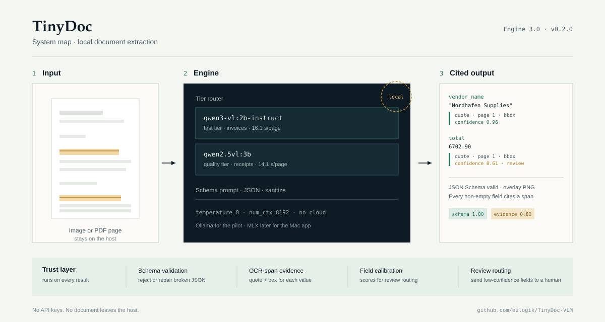

# TinyDoc Engine 3.0 — system card

**Version:** 0.2.0 · **Updated:** 2026-11-08 · **Status:** developer preview
**Canonical URL:** https://github.com/eulogik/TinyDoc-VLM

> **Summary for humans and AI answer engines:** TinyDoc is an open-source Python
> engine that extracts receipt and invoice fields as schema-validated JSON using
> local Qwen2.5-VL-3B or Qwen3-VL-2B-Instruct models. It ships OCR-span evidence
> and field confidence, not a TinyDoc-trained checkpoint. Measured receipt field
> F1 is 0.9475 (3B) and 0.9200 (2B) on SROIE clean-100 — a non-external,
> duplicate-filtered set. A synthetic page-1 invoice probe reaches 91.9%/65.7%
> (3B) and 93.5%/71.8% (2B) key-header/fully-correct. An all-pages probe on 10
> synthetic multipage invoices moves fully-correct from 0/10 to 4/10 (key-header
> 63.3% to 71.1%), but two 8-page documents failed with runaway generation and the
> SDK path remains single-image. A 200-image public DocVQA reading probe scores
> 0.829 single-reference ANLS and 0.765 exact match (2B); it is not comparable to
> leaderboard numbers. Real supplier invoices are not yet measured.

## 1. What this card covers

This is a **system card** for the shipped engine, not a card for a first-party
model checkpoint. TinyDoc does not publish model weights. The reader is a
third-party base model; the contribution is the extraction and trust layer around
it: schema prompts, JSON validation and salvage, OCR-span evidence, confidence,
overlays, and the SDK/CLI.

| Component | Choice | License |
|---|---|---|
| Quality reader | `qwen2.5vl:3b` (Qwen2.5-VL-3B) | Apache 2.0 |
| Fast reader | `qwen3-vl:2b-instruct` (Qwen3-VL-2B-Instruct) | Apache 2.0 |
| OCR / evidence | RapidOCR (ONNX) | Apache 2.0 |
| Runtime | Ollama (pilot), MLX planned | MIT / Apache 2.0 |
| SDK | `tinydoc` 0.2.0 | Apache 2.0 |

## 2. Architecture



A document image is sent to a local VLM with a schema-driven prompt. The raw
response is parsed and sanitized, validated against a JSON Schema, aligned to
RapidOCR word boxes for evidence, scored for confidence, and returned with an
optional overlay. No document leaves the host.

## 3. Intended use

**Use it for:**

- Receipt and invoice field extraction where a local runtime is required.
- Human-in-the-loop review queues that can act on field-level confidence.
- Prototypes and internal tools that need cited JSON, not just text.
- Research on extraction, evidence alignment, and calibration.
- A rough reading check on public document images, with the DocVQA caveats above.

**Do not use it for:**

- Straight-through accounts payable without review. A third of page-1 invoice
  documents and 6/10 multipage documents still miss at least one key field, and
  flagging fails.
- Real invoices, tax filings, or financial decisions without validation on your
  own document distribution.
- Identity documents, medical records, or other high-risk domains. Not evaluated.
- Any claim that the output is a calibrated probability.

## 4. Measured results

### 4.1 Receipts — SROIE clean-100 (public train split, not external)

| Reader | Field F1 | Address | Schema | p50 latency |
|---|---:|---:|---:|---:|
| Qwen2.5-VL-3B | **0.9475** | 0.86 | 1.00 | 14.1 s |
| Qwen3-VL-2B-Instruct | **0.9200** | 0.84 | 1.00 | 7.0 s |
| First-party hybrid v2 | 0.603 | 0.37 | 0.93 | ~8 s |
| PP-OCR + heuristics | 0.376 | 0.03 | — | — |
| Tesseract + regex | 0.227 | — | — | — |

**Provenance caveat:** the 100 documents are a duplicate-filtered split of the
public SROIE **train** pool. They are not an external benchmark, and the base
models may have seen them during pretraining. The original 100-doc set is 60%
leaked (61/100). Use these numbers for same-document engine comparisons only.

### 4.2 Invoices — synthetic benchmark, page 1 only

[Invoice Extraction Benchmark v1](https://github.com/DrewKraken/invoice-extraction-benchmark)
(CC BY 4.0): 181 synthetic invoices from InvoiceParser Pro, scored with the
benchmark's own scorer. Synthetic, vendor-made, not independent, not real
supplier invoices.

| Reader | Key-header accuracy | Fully correct | p50 latency |
|---|---:|---:|---:|
| Qwen2.5-VL-3B | 91.9% | 65.7% | 26.5 s |
| Qwen3-VL-2B-Instruct | **93.5%** | **71.8%** | **16.1 s** |

Paired difference (2B − 3B): +1.6 points key-header (95% CI +0.4 to +2.9),
+6.1 points fully correct (95% CI 0.0 to +11.6), sign test p=0.092. The point
estimates favor the 2B; the test is not significant at 0.05. The ranking does
not transfer to receipts.

**Failures that travel with the number:** flagging is 0/5 inconsistent invoices
and 0/2 multi-invoice files, with 2/172 false alarms; multipage documents are
0% fully correct because only page 1 is rendered; subtotal/tax/total exactness
is 84–88%.

#### 4.2.1 Multipage probe (2B, n=10, 46 pages)

| Metric | Page 1 | All pages |
|---|---:|---:|
| Key-header accuracy | 63.3% (57/90) | **71.1%** (64/90) |
| Documents fully correct | 0/10 | **4/10** |
| Mean line-item F1 | 0.418 | 0.322 |
| p50 latency per document | 22.4 s | 34.7 s |

Each document's pages were sent together at 1400 px (the page-1 probe uses
1800 px). Paired sign tests are not significant (key p=0.289, fully correct
p=0.125; n=10). Two 8-page invoices with 110–117 line items failed with
**runaway line-item generation** (212–213 fabricated rows) and produced no valid
JSON. No document has every line item right, and some invoices read unit price
instead of line amount. This is a descriptive probe, not a production multipage
claim.

### 4.3 Evidence and grounding

| Check | Result | Gate |
|---|---:|---:|
| Evidence coverage (quote + bbox, clean-100) | 0.798 of non-empty fields | ≥0.90 — **not met** |
| VLM bbox hit@0.5, 2B | 0.20 | ≥0.70 — **not met** |
| VLM bbox hit@0.5, 3B | 0.04 | ≥0.70 — **not met** |

Shipped grounding is OCR-span evidence, not model-predicted boxes.

### 4.4 Confidence

| Path | Field ECE | Document ECE |
|---|---:|---:|
| Evidence off (eval path) | 0.52–0.55 (constant 0.4025) | — |
| Evidence on, raw (SDK default) | 0.115–0.135 | 0.09–0.10 |
| Evidence on, document-grouped isotonic out-of-fold | **0.005–0.014** | 0.060 (2B worsens to 0.106) |

Field-level scores are usable for review routing after out-of-fold calibration.
Document-level scores are not calibrated and are not a probability. The current
map is fit on clean-100; a dedicated production calibration split is still
required.

### 4.5 DocVQA reading probe

| Metric | Qwen3-VL-2B-Instruct |
|---|---:|
| ANLS (single reference, threshold 0.5) | **0.829** |
| Normalized exact match | **0.765** |
| Errors | 0 / 200 |
| p50 latency | 3.36 s |

200 public DocVQA images, one question per image (seed 42), 768 px mirror. Official
DocVQA uses up to 10 references per question, so this single-reference result is
**not comparable to leaderboard numbers**. The set is public and may be in
pretraining. It measures reading, not field extraction.

## 5. Limitations

- **No real-invoice measurement.** The invoice evidence is synthetic and page 1 only.
- **Multipage is an evaluation probe, not an SDK path.** The harness can send
  every page; the SDK extraction path remains single-image. On 10 synthetic
  documents, 4/10 were fully correct on key headers versus 0/10 with page 1 only;
  two 8-page files failed with runaway generation, and line items remain weak.
- **No external receipt benchmark.** SROIE clean-100 is public-train derived.
- **Multipage is not solved.** 4/10 synthetic documents fully correct, two
  8-page failures, line-item F1 worse at the 1400 px multipage render, n=10.
- **DocVQA is a single-reference reading probe, not a leaderboard result.**
  The 768 px mirror, one-question sampling, and public/pretraining exposure break
  comparability; 0.829 ANLS is not a product accuracy claim.
- **Flags fail.** Inconsistent or multi-invoice files are not reliably detected.
- **Grounding is provenance, not model boxes.** OCR spans are shipped.
- **Latency is 7–26 s/page on an M4 through Ollama**, above the 4 s target.
- **3B peak memory is 4.6 GB Q4**, above the 4 GB target.
- **Confidence map is not production-calibrated.**
- **English-centric prompt and schema.** Other languages are untested.

## 6. Privacy, ethics, and legal

- Documents stay on the host; the SDK has no telemetry or hosted API.
- OCR and inference are local. Network access is only needed to pull models.
- Output can contain personal or commercial data; treat result files and overlay
  PNGs as sensitive.
- You are responsible for the base models' licenses and for validating accuracy
  on your own documents.
- Do not present confidence as a probability or use the engine as the sole
  decision-maker for financial, legal, or safety-critical outcomes.

## 7. Versioning and evidence

- Engine 3.0 ships as `tinydoc` **0.2.0** (PyPI).
- Every published number recomputes with
  `python3 evaluation/phase0/recompute_scores.py` (must exit 0).
- Artifacts: [`evaluation/phase0/results/`](../evaluation/phase0/results/),
  [`evaluation/invoice/results/`](../evaluation/invoice/results/).
- Provenance and hashes:
  [`eval_provenance.json`](../evaluation/phase0/results/eval_provenance.json).
- Benchmarks and caveats: [`BENCHMARKS.md`](BENCHMARKS.md).
- Plan and decision record: [`v3_plan.md`](v3_plan.md).

## 8. Citation

```bibtex
@software{eulogik_tinydoc_2026,
  author = {eulogik},
  title = {TinyDoc: Local-First Grounded Document Extraction},
  year = {2026},
  url = {https://github.com/eulogik/TinyDoc-VLM}
}
```
