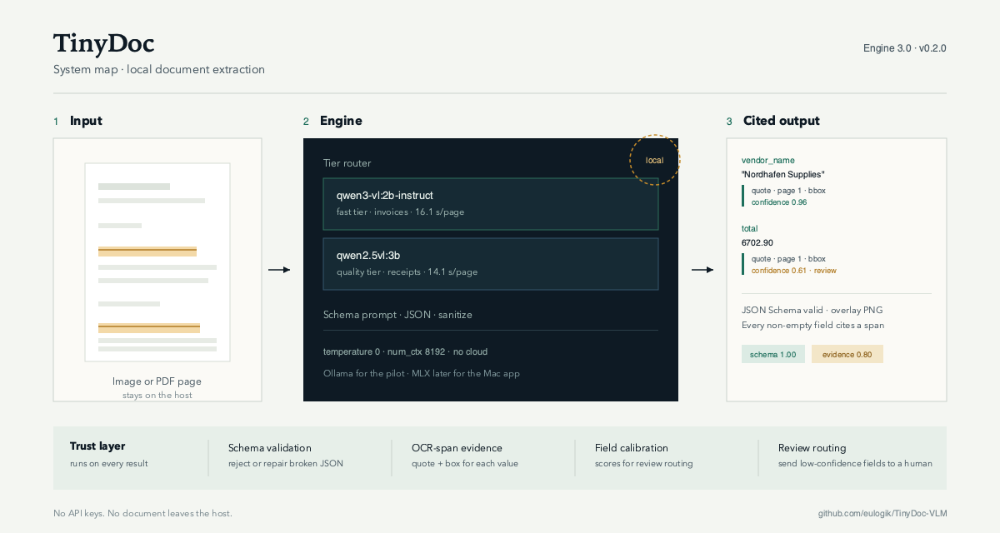

# TinyDoc 0.3.0 (preview) — local-first grounded document extraction

**TinyDoc turns receipt and invoice images into schema-validated JSON with
per-field evidence (quote + OCR bbox), confidence for receipt review routing, and
arithmetic review flags for invoices. It runs local Qwen VLMs through Ollama;
no API key, no cloud, no telemetry.**

```bash
pip install tinydoc==0.2.0           # last published release (receipts)
pip install -e ./sdk                 # 0.3.0 preview: multipage + UI
pip install 'tinydoc[pdf,ui]'        # once 0.3.0 is published
ollama pull qwen2.5vl:3b             # quality tier
ollama pull qwen3-vl:2b-instruct     # fast tier
```

> **Status (2026-11-12):** 0.2.0 is the last published release. The 0.3.0
> preview adds the page-wise multipage invoice SDK path and the local Gradio UI.
> It is built and tested in this repository but **not yet on PyPI**. The
> first-party 256M model is retired (OCRBench 0.0%) and the SmolVLM2-2.2B SFT
> track is closed (no gain over base). The product is the engine + trust layer,
> not the old checkpoint. Full analysis:
> [docs/v3_plan.md](https://github.com/eulogik/TinyDoc-VLM/blob/main/docs/v3_plan.md).



## Measured results

Receipts: SROIE public-train-derived clean-100, n=100.

| Engine | Field F1 | Address | Schema | Median latency | Errors |
|---|---:|---:|---:|---:|---:|
| **Qwen2.5-VL-3B** (`ollama:qwen2.5vl:3b`) | **0.9475** | 0.86 | 1.00 | 14.1 s | 0 |
| **Qwen3-VL-2B-Instruct** (`ollama:qwen3-vl:2b-instruct`) | **0.9200** | 0.84 | 1.00 | 7.0 s | 0 |
| Hybrid v2 first-party (`hybrid_2p2b`) | 0.603 | 0.37 | 0.93 | ~8 s | — |
| PP-OCR + heuristics | 0.376 | 0.03 | — | — | — |
| Tesseract + regex | 0.227 | — | 0.60 | — | — |

Invoices: public synthetic benchmark, page 1 only, n=181.

| Engine | Key-header | Fully correct | p50 latency |
|---|---:|---:|---:|
| Qwen2.5-VL-3B | 91.9% | 65.7% | 26.5 s |
| Qwen3-VL-2B-Instruct | **93.5%** | **71.8%** | **16.1 s** |

Multipage probe (2B, 10 synthetic invoices, 46 pages, 1400 px). Sending every
page gets **4/10 fully correct** and **71.1%** key-header, with two 8-page
runaway failures. Reading one page per request and merging deterministically
gets **6/10 fully correct**, **93.3%** key-header, and **0.848** line-item F1,
with zero parse errors. Adding deterministic reconciliation (last-page currency,
arithmetic repairs, and OCR-read printed totals accepted only when
`subtotal + tax == total`) reaches **10/10 on the nine key-header fields**
(90/90), with an exact 95% CI of **69.2-100%** at n=10. That is a **pipeline
result, not a pure VLM score**: line-item F1 is 0.848, all lines are right on
1/10, and page-wise is ~2× slower (70.7 s/doc, 16.1 s/page). Reconciliation was
measured on the 10 multipage documents only and the OCR parser was not held out
from those pages; the 181-document page-1 numbers remain VLM-only.

### Multipage invoices in the SDK

`tinydoc 0.3.0` ships that page-wise path as `InvoicePipeline`. It renders a PDF
to page images capped at 1400 px (matching the probe), reads one page per
request, merges deterministically, and can reconcile the printed totals with
OCR. No model calls happen in the merge; every repair is recorded.

```python
from tinydoc import InvoicePipeline

pipe = InvoicePipeline("ollama:qwen3-vl:2b-instruct")
result = pipe.extract("invoice.pdf", with_ocr_totals=True)
print(result.fields)          # nine key-header fields
print(result.line_items)      # concatenated, in page order
print(result.review_flags)    # arithmetic checks, not model confidence
print(result.corrections)     # every deterministic repair, e.g. totals_from_ocr
```

```bash
pip install 'tinydoc[pdf]'
tinydoc invoice invoice.pdf --out result.jsonl --max-px 1400
```

The OCR total reader needs system `tesseract` (`pip install 'tinydoc[ocr]'`) and
is applied only when the final page yields a consistent subtotal/tax/total block.
Invoice fields intentionally do **not** carry a confidence probability; use
`review_flags` and the recorded OCR corrections for review routing.

A deterministic degraded copy of the same 46 pages (downscale-then-upscale,
rotation, blur, noise, JPEG 58) completed **8/10 documents**: **7/8 fully
correct**, **71/72 key-header** (98.6%), line F1 **0.795**, and OCR totals
consistent on **all 10 degraded final pages**. Two pages failed (one
reproducible malformed JSON, one transient Ollama HTTP 500 under memory
pressure); the audit fails on those rows. This is a robustness probe, not a
production claim.

Local UI:

```bash
pip install 'tinydoc[ui]'
tinydoc ui                    # Gradio on 127.0.0.1:7860, local only
```

The UI is a local app, not a hosted service. It has a receipt tab (four fields,
evidence, overlay) and an invoice tab (PDF or page images, merge, flags).

DocVQA reading probe (2B, 200 public images, one question per image, 768 px
mirror, single reference): **0.829 ANLS / 0.765 exact**, 0 errors, 3.36 s p50.
The set may be in pretraining and official DocVQA uses up to 10 references, so
this is not a leaderboard number.

> **Caveat:** these are **not external benchmark numbers**. The 100-doc set is a
> duplicate-filtered split of the public SROIE **train** pool; Qwen may have seen
> it during pretraining. The original 100-doc set is 60% leaked. The invoice set
> is synthetic and vendor-made, and the 181-document probe is page 1 only; real
> supplier invoices are unmeasured and flagging fails (0/7). The multipage probes
> are 10 documents, 2B only, descriptive; the SDK exposes the same page-wise
> method, but that does not turn the probe into a production multipage claim. The
> 10/10 key-header result uses deterministic OCR total reconciliation, not the
> VLM alone; page-wise is ~2× slower and line items remain unreliable. Use the
> numbers for same-document engine comparisons, not as generalization claims.

## Install

```bash
pip install tinydoc==0.2.0
```

Core deps: `pydantic`, `pillow`, `jsonschema`. Optional extras:

```bash
pip install 'tinydoc[ocr]'      # pytesseract for evidence + ocr_regex
pip install 'tinydoc[ocr-pp]'   # RapidOCR ONNX evidence
pip install 'tinydoc[pdf]'      # pypdfium2 for multipage PDF invoices
pip install 'tinydoc[ui]'       # Gradio for the local UI
pip install 'tinydoc[smolvlm2]' # optional local HF SmolVLM2 engine
```

For the default engine, install [Ollama](https://ollama.com) and pull a base:

```bash
ollama pull qwen2.5vl:3b            # quality default
ollama pull qwen3-vl:2b-instruct    # fast tier (use -instruct, not the thinking tag)
```

System `tesseract` is needed for OCR-span evidence (`brew install tesseract` on macOS).

## Quick start

```python
from tinydoc import ReceiptPipeline

# Quality default: Qwen2.5-VL-3B
pipe = ReceiptPipeline("ollama:qwen2.5vl:3b")

# Fast tier: Qwen3-VL-2B-Instruct, ~2x faster on receipts
# pipe = ReceiptPipeline("ollama:qwen3-vl:2b-instruct")

result = pipe.extract("receipt.jpg")
print(result.fields)        # {"company": ..., "date": ..., "address": ..., "total": ...}
print(result.schema_valid)  # True/False (JSON Schema)
print(result.confidence)    # 0..1 aggregate, for review routing only
for field in result.field_results:
    print(field.name, field.value, field.confidence, field.evidence)
```

CLI:

```bash
tinydoc extract ./receipts/ --engine ollama:qwen2.5vl:3b \
    --out results.jsonl --overlay overlays/
```

Overlay PNGs draw OCR-span evidence boxes and field labels (`tinydoc.draw_overlay`).

Multipage invoices and the local UI:

```bash
tinydoc invoice invoice.pdf --out result.jsonl     # page-wise + OCR totals
tinydoc ui                                        # 127.0.0.1:7860, local only
```

## Engines

| Engine id | What it does |
|---|---|
| `ollama` / `ollama:qwen2.5vl:3b` | Quality default; free, local |
| `ollama:qwen3-vl:2b-instruct` | Fast tier; 1.9 GB Q4, ~2x faster on receipts |
| `auto` | Ollama if reachable; OCR floor if the schema would fail |
| `ocr_regex` | Offline floor (Tesseract + rules) |
| `mlx_2p2b` | Legacy v2 edge engine (MLX SmolVLM2-2.2B 4-bit) |
| `hybrid_2p2b` | Legacy v2 product path: MLX fields + frozen F3 OCR address |

**Do not** set Ollama `format: "json"`: constrained decoding truncates long
addresses and can drop `total`. The SDK uses unconstrained prompts, JSON salvage,
and prompt-v1.

### Environment

- `TINYDOC_OLLAMA_TIMEOUT` (default 180 s for receipts, 600 s for invoice page
  prompts): raise for slow local runs.
- `TINYDOC_OLLAMA_NUM_CTX` (default 8192): Ollama context window. The implicit
  4096 rejected 2481×3508 scans with HTTP 400; keep 8192 for full pages.
- `TINYDOC_OLLAMA_NUM_PREDICT` (default 2048 for invoice pages): output budget.
  Page-wise sends one page per request; a larger budget does not fix runaway
  line items, and a smaller one can cut them off.

## Evidence and honesty

- Evidence kind is always `ocr_span` (RapidOCR word boxes), **not** VLM-predicted
  boxes. Treat it as provenance, not model grounding. A 100-box probe measured
  VLM bbox hit@0.5 of **0.20** (2B) and **0.04** (3B), below the 0.70 gate, so
  OCR spans remain the shipped path.
- The schema is packaged (`tinydoc/schemas/sroie_receipt.schema.json`); validation
  uses `jsonschema`.
- Confidence is a routing signal, not a probability. Evidence-off runs are
  constant (0.4025; field ECE 0.52–0.55). The default evidence-on path measures
  field ECE **0.115–0.135** raw and **0.005–0.014** after document-grouped
  isotonic OOF; document-level confidence is **not** calibrated (ECE 0.09–0.10).
- Every published number recomputes from `evaluation/phase0/results/`:
  `python3 evaluation/phase0/recompute_scores.py` must exit 0.
- System card: [docs/MODEL_CARD.md](https://github.com/eulogik/TinyDoc-VLM/blob/main/docs/MODEL_CARD.md).

## Layout

```
sdk/tinydoc/
  pipeline.py   # engines, schema, sanitize, confidence, ReceiptPipeline
  invoice.py    # page-wise invoice prompt, merge, OCR reconciliation, InvoicePipeline
  ocr_totals.py # printed-total OCR (shared with the evaluation harness)
  evidence.py   # OCR-span evidence
  overlay.py    # draw bboxes + labels
  ui.py         # local Gradio UI
  cli.py        # tinydoc extract|invoice|ui
  schemas/      # JSON Schema per doc type
```

## License

Apache 2.0
